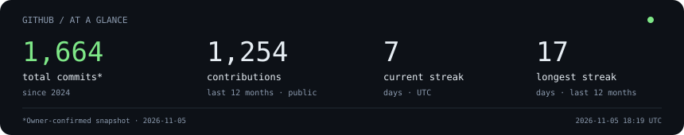

  

My little corner of GitHub — building, experimenting, and improving one commit at a time.

  <a href="https://github.com/Lokith007?tab=repositories">Explore my repositories ↗</a>
  &nbsp; · &nbsp;
  <a href="https://github.com/Lokith007/Lokith007/actions/workflows/profile.yml">Stats refresh ↗</a>

  

About the numbers

- **Total commits: 1,664 since 2024**, confirmed by Lokith on November 5, 2026. This is a dated snapshot, not a live public-API total. It is stored in `profile-config.json` and is never overwritten by the daily refresh.
- **Contributions and streaks** use GitHub's public contribution calendar for the last 12 months. Contributions can include commits, issues and pull requests. These public totals can differ from account-wide totals that include private activity.
- **Current streak** allows an unfinished UTC day: if today has no contributions yet, yesterday's streak remains current. The longest streak is within the displayed 12-month window.
- Public stats refresh daily through GitHub Actions. The timestamp shows the last successful refresh. Animations respect reduced-motion preferences.

Thanks for stopping by.

